# NetTriage

[](https://github.com/Srujan641/nettriage/actions/workflows/ci.yml)


**A network troubleshooting toolkit.** Give it a hostname or URL. It runs the checks a support engineer would run by hand (DNS, ping, traceroute, MTR, path MTU, TCP ports, TLS, HTTP) and says in one sentence which layer is broken and why.

```
$ nettriage expired.badssl.com

VERDICT: BROKEN
  DNS resolves fine, TCP 443 is open, but the TLS handshake fails because the
  certificate expired 4230 days ago (2015-04-12).
```

It also decodes packet captures and points at the packets that explain a failure. It ships with a Docker lab of four deliberately broken networks, each captured to `.pcap` and written up for Wireshark.

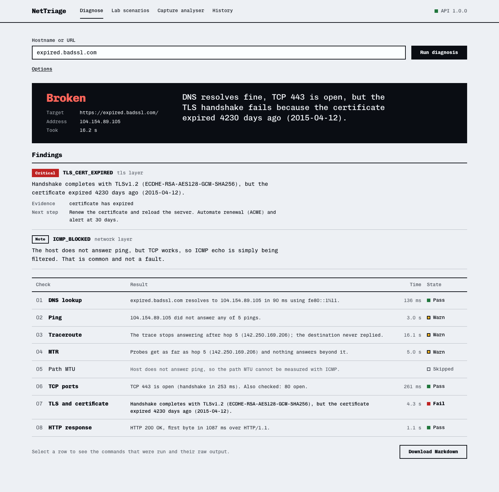

## Contents

- [Results at a glance](#results-at-a-glance)
- [What it checks](#what-it-checks)
- [Screenshots](#screenshots)
- [Quick start](#quick-start)
- [Command-line use](#command-line-use)
- [The lab: four broken networks](#the-lab-four-broken-networks)
- [Test results](#test-results)
- [Security](#security)
- [How it works](#how-it-works)
- [Project layout](#project-layout)
- [Limitations](#limitations)

## Results at a glance

All measured, not estimated. The details and raw data are under [Test results](#test-results).

| | |
|---|---|
| **Root-cause accuracy** | Correct in **22 of 23** runs against targets with known faults, across **12 fault types** |
| **False alarms** | **0 of 7** runs against healthy targets |
| **Lab** | **5 of 5** planted faults diagnosed correctly |
| **Packet-capture analysis** | **7 of 7** captures (670 packets) analysed correctly |
| **Automated tests** | **90 passing**, **79%** line coverage of the backend |
| **Security scans** | 0 secrets (gitleaks), 0 high- or medium-severity issues (bandit), 0 vulnerable dependencies (pip-audit, npm audit) |
| **Time to a verdict** | median **13 s** for all eight checks |

## What it checks

| # | Check | Tool | What it establishes |
|---|---|---|---|
| 1 | DNS lookup | `dig` | Does the name resolve? If not: NXDOMAIN, SERVFAIL, or a resolver that never answers? If your resolver fails, public resolvers are asked too, to tell a bad name from a bad resolver. |
| 2 | Ping | `ping` | Packet loss, latency and jitter |
| 3 | Traceroute | `traceroute` | The route, and the last hop that answers |
| 4 | MTR | `mtr`, or a built-in equivalent | Loss and latency per hop, and whether loss is real or a router rate-limiting ICMP |
| 5 | Path MTU | `ping` with Don't-Fragment set | The largest packet the path carries, and whether bigger ones vanish without an ICMP error |
| 6 | TCP ports | TCP `connect()`, plus `nmap` if installed | Open, closed (answered with RST) or filtered (silence) |
| 7 | TLS | `openssl s_client` | Handshake, certificate dates, names and chain, and which TLS versions the server accepts |
| 8 | HTTP | `curl` | Status code, redirects, and timing for connect, TLS and first byte |

A rules engine then reads across the results. It reports the **first layer that fails** and uses the other checks to explain it. A closed port is reported once, not also as a TLS failure and an HTTP failure. A host that ignores ping but serves HTTPS gets a note, not an alarm.

Every finding carries the evidence it rests on and a concrete next step. Every command that ran is kept with its raw output, so the verdict can be checked by hand.

## Screenshots

**Diagnose.** Enter a target and watch the checks land live.

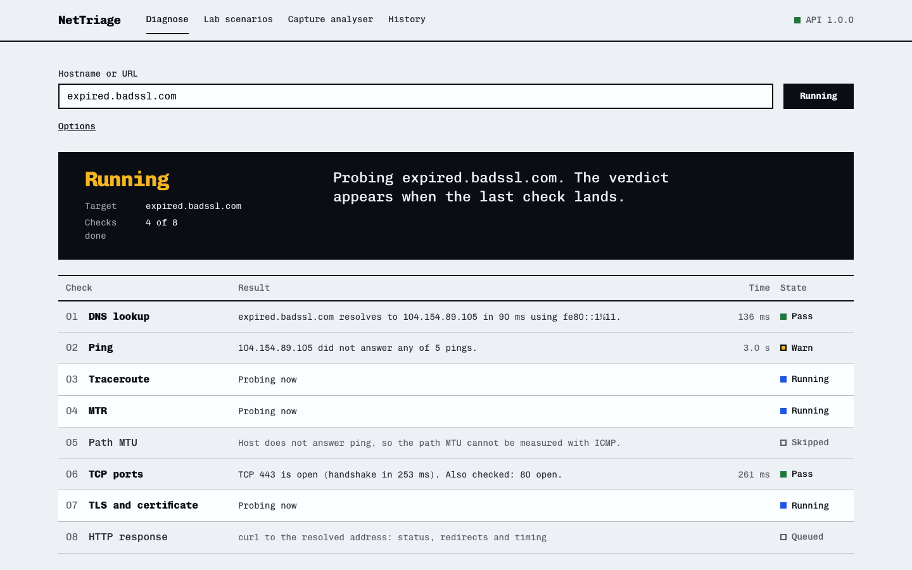

**Evidence.** Select any check to see the structured result and the exact commands that produced it.

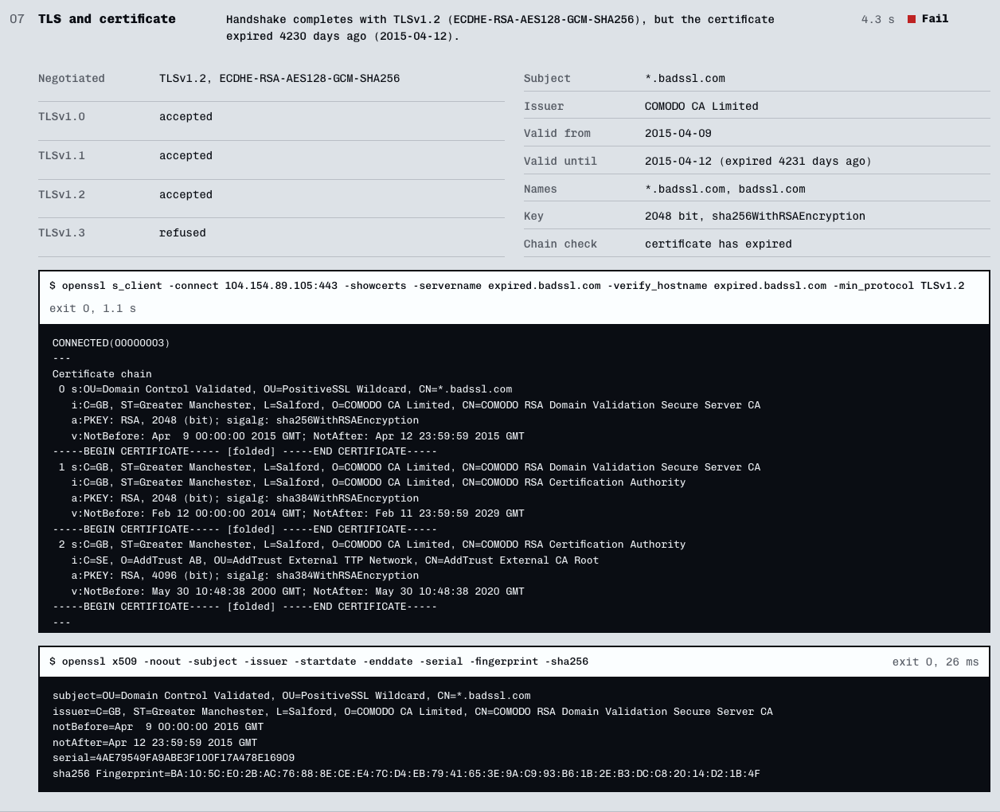

**Lab scenarios.** Each planted fault comes with a write-up, the tool's report, and its packet captures.

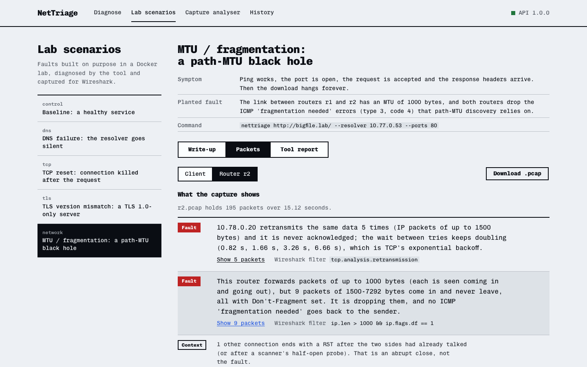

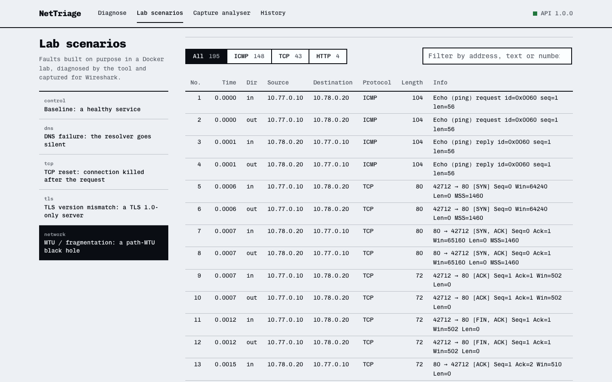

**Capture analyser.** Drop in any `.pcap` or `.pcapng` file and get the packets that matter, with ready-made Wireshark filters.

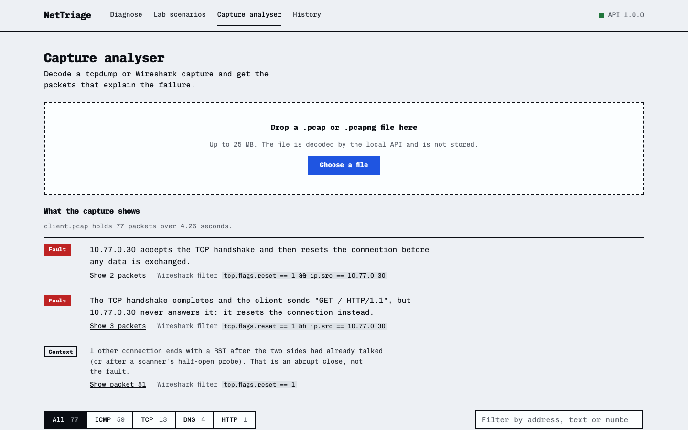

**History.** Every diagnosis is saved, and can be reopened or exported as Markdown.

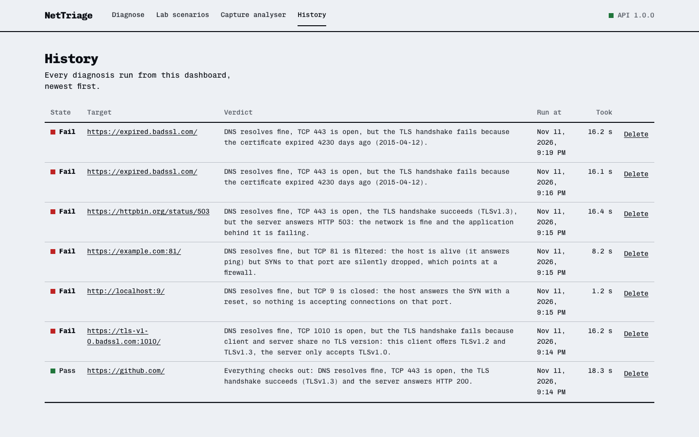

<details>
<summary>More screenshots</summary>

The start page:

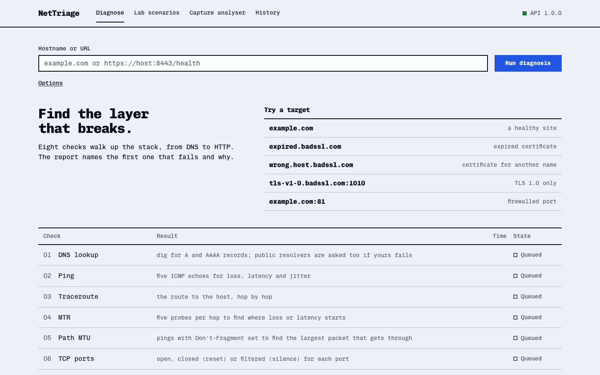

A lab scenario's write-up:

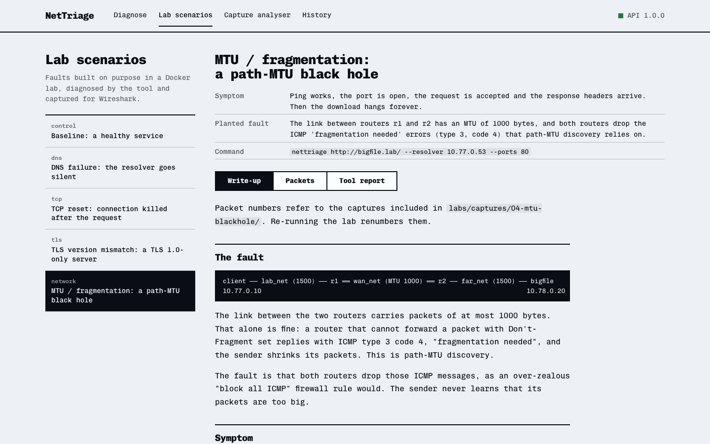

The tool's report for the TCP reset scenario:

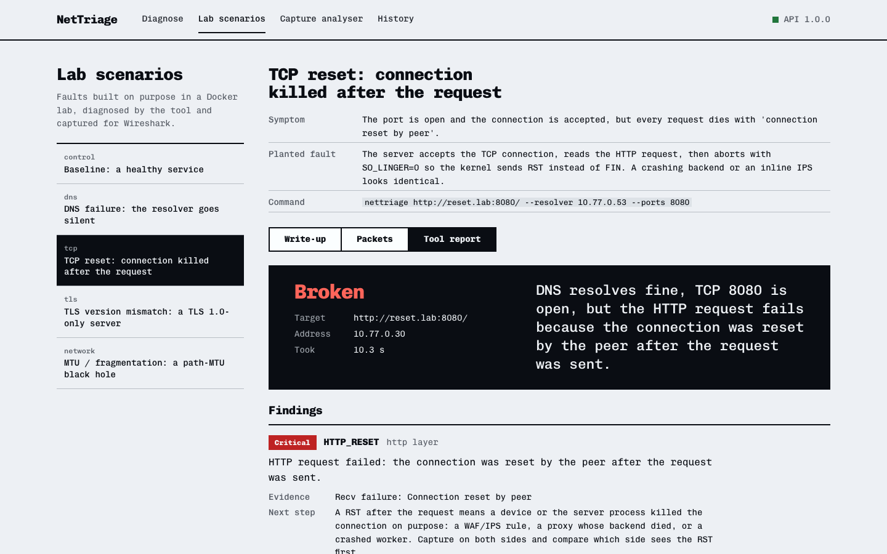

On a phone:

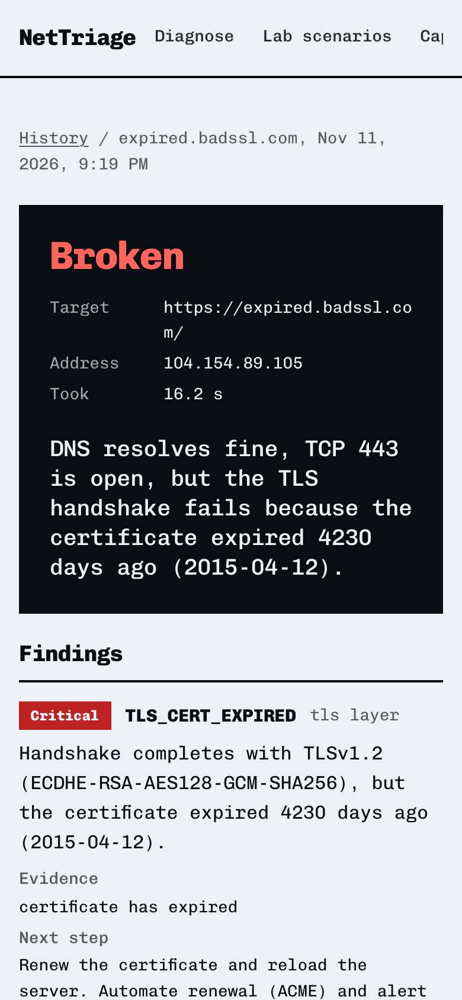

</details>

## Quick start

Needs Python 3.10+, Node 20+, and the standard network tools: `dig`, `ping`, `traceroute`, `openssl`, `curl`. `mtr` and `nmap` are optional; without them NetTriage uses its own equivalents. Docker is needed only for the lab.

```bash
git clone https://github.com/Srujan641/nettriage.git
cd nettriage
make setup      # Python virtualenv + frontend packages
make dev        # API on 127.0.0.1:8000, dashboard on http://localhost:5173
```

Run `make` on its own to list every task.

## Command-line use

The CLI has no third-party dependencies.

```bash
cd backend
./.venv/bin/nettriage example.com                       # full diagnosis
./.venv/bin/nettriage https://host:8443/health -v       # also print every command and its raw output
./.venv/bin/nettriage example.com --ports 22,80,443     # check extra ports
./.venv/bin/nettriage example.com --resolver 1.1.1.1    # use a specific DNS server
./.venv/bin/nettriage example.com --tls-max 1.2         # see what an older client sees
./.venv/bin/nettriage example.com --json                # machine-readable report (or --markdown)
./.venv/bin/nettriage example.com -o report.md          # save the report
sudo ./.venv/bin/nettriage example.com --pcap out.pcap  # record the traffic for Wireshark
./.venv/bin/nettriage pcap out.pcap                     # analyse a capture
```

Exit codes: `0` healthy, `1` degraded, `2` broken, so it can gate a script or act as a monitoring check.

## The lab: four broken networks

[`labs/`](labs/) is a Docker Compose network with its own DNS server, a healthy control server, and four faults built on purpose:

```
client ──┬── dns         lab resolver: answers, says NXDOMAIN, or stays silent
         ├── healthy     control: valid certificate, TLS 1.3, HTTP 200
         ├── reset       accepts the connection, reads the request, sends RST
         ├── legacy-tls  speaks TLS 1.0 only
         └── r1 ══ 1000-byte link ══ r2 ── bigfile     both routers drop ICMP "fragmentation needed"
```

| Scenario | The fault | What NetTriage reported | Write-up |
|---|---|---|---|
| DNS failure | The resolver receives queries and never answers | "DNS fails: 10.77.0.53 does not answer DNS queries." | [01-dns-failure](docs/scenarios/01-dns-failure.md) |
| TCP reset | The server reads the request, then aborts with RST | "TCP 8080 is open, but the HTTP request fails because the connection was reset by the peer after the request was sent." | [02-tcp-reset](docs/scenarios/02-tcp-reset.md) |
| TLS version mismatch | The server accepts TLS 1.0 only | "TCP 443 is open, but the TLS handshake fails because client and server share no TLS version: this client offers TLSv1.2 and TLSv1.3, the server only accepts TLSv1.0." | [03-tls-version-mismatch](docs/scenarios/03-tls-version-mismatch.md) |
| Path-MTU black hole | A 1000-byte link, with the ICMP errors that would reveal it dropped | "TCP 80 is open, but the HTTP response stalls because of a path-MTU black hole: only packets up to 1000 bytes cross the path…" | [04-mtu-blackhole](docs/scenarios/04-mtu-blackhole.md) |

A [baseline](docs/scenarios/00-baseline.md) run against the healthy server shows what a clean capture looks like.

Each write-up walks through the capture packet by packet, with Wireshark display filters, how to tell this fault from similar ones, and the fix. The MTU scenario is captured at two points, the client and the router next to the server. The router capture shows the oversized packets arriving and never leaving.

```bash
make lab-run    # build the lab, run every scenario, record reports and captures
make lab-down   # tear it down
```

The recorded captures are in [`labs/captures/`](labs/captures/), so the write-ups can be followed in Wireshark without running Docker.

## Test results

### Automated tests: 90 passing, 79% coverage

```bash
make test           # all 90 tests, including 4 that use the internet
make test-offline   # the 86 that need no internet (these also run in CI)
make coverage       # with a line-coverage report
```

| Test file | Tests | What it covers |
|---|---|---|
| `test_diagnosis.py` | 11 | The rules engine: the right root cause for each fault, first broken layer wins, no false alarm for blocked ping, the exact sentence from the project brief |
| `test_pcap.py` | 12 | The capture decoder on synthetic packets and on the real lab captures: every planted fault found, nothing flagged on the healthy baseline |
| `test_cli.py` | 11 | Arguments, JSON and Markdown output, exit codes, rejection of bad input |
| `test_api.py` | 7 | Endpoints, live streaming, input validation, path-traversal attempts |
| `test_network_checks.py` | 7 | Ping, traceroute, MTR, path MTU and port states, run for real against the loopback address |
| `test_parsers.py` | 6 | Parsing ping and mtr output from macOS and Linux, certificate name matching, redaction of TLS session secrets |
| `test_util.py` | 4 | Target validation, including injection attempts |
| `test_live.py` | 4 | End to end against the internet: a healthy site, an expired certificate, a wrong-name certificate, a closed port |

Coverage by module on the last run: `render` and `models` 100%, `engine` 96%, `cli` 94%, `pcap` 86%, `ports` 85%, `diagnosis` 83%, `util` 82%, `api` 79%, `network` 71%, `tls` 69%, `http` 58%, `dns` 57%. The TLS, HTTP and DNS checks are lower because many of their failure branches need a broken server to reach. Those branches are exercised end to end by the lab and the benchmark below.

### Root-cause accuracy benchmark

[`scripts/benchmark.py`](scripts/benchmark.py) runs the real tool against 18 targets whose fault is known in advance. A fault case passes only if the tool's top finding is the expected one. A healthy case passes only if it raises no critical finding. Internet targets ran twice and lab targets once, for 30 runs in total.

| Measure | Result |
|---|---|
| Correct root cause, fault runs | **22 of 23** |
| False alarms, healthy runs | **0 of 7** |
| Fault types covered | 12: NXDOMAIN, DNS timeout, closed port, filtered port, connection reset, expired certificate, wrong-name certificate, self-signed certificate, untrusted root, TLS version mismatch, HTTP 5xx, path-MTU black hole |
| Time for all eight checks | median 13.2 s, 90th percentile 18.3 s |

The one miss: on the first of two runs, `expired.badssl.com` stopped accepting connections mid-test, so the tool reported a filtered port. It passed on the second run. It is counted as a failure, not re-run until clean.

Every case, with the expected and the reported finding, is in [docs/METRICS.md](docs/METRICS.md). Re-run it with `make bench`.

### Packet-capture analyser

| Capture | Packets | Must flag | Result |
|---|---|---|---|
| Baseline (healthy) | 145 | nothing | pass: 0 faults flagged |
| DNS, silent resolver | 4 | DNS | pass |
| DNS, NXDOMAIN | 4 | DNS | pass |
| TCP reset | 77 | TCP | pass |
| TLS version mismatch | 123 | TLS | pass |
| MTU black hole, client side | 122 | MTU, TCP | pass |
| MTU black hole, router side | 195 | MTU, TCP | pass |

**7 of 7 correct**, 670 packets in total. The analyser decodes about 150,000 packets per second (pure Python, one thread, on the development machine).

## Security

Checked before publishing. The full report is in [docs/SECURITY.md](docs/SECURITY.md).

| Check | Result |
|---|---|
| Secret scan (gitleaks) | 0 findings |
| Static analysis (bandit) | 0 high, 0 medium, 4 low. All four note that external programs are started, which is the tool's purpose; they run without a shell, on validated input. |
| Dependency vulnerabilities (pip-audit, npm audit) | 0 |
| API attack probes: command injection, option injection, path traversal, oversized upload, cross-site requests | all rejected |
| Personal data in the repository | none |

The review found and fixed one real issue. After a TLS 1.2 handshake, `openssl` prints the session's master key, and the tool was storing that output in reports. It is now redacted before anything is saved, and a test keeps it that way.

The API starts network probes, so it binds to `127.0.0.1` only. **Only test hosts you own or are authorised to test.**

## How it works

```
   Dashboard (React)                 CLI
        │ HTTP + server-sent events   │
   API (FastAPI, localhost) ──────────┤
                                      ▼
                         engine: DNS first, then network checks
                         in parallel with TCP → TLS → HTTP
                                      │
    dig · ping · traceroute · mtr · DF-ping sweep · connect()/nmap · openssl · curl
                                      │
                    diagnosis rules → one headline + findings with next steps
```

Design decisions worth knowing:

- **Every later check is pinned to the address DNS returned** (`curl --resolve`, `openssl s_client -connect <ip> -servername <host>`), so all layers test the same server.
- **The TLS check behaves like a current browser**, offering TLS 1.2 and 1.3. Support for older versions is measured separately, one connection per version.
- **One root cause, not a list of symptoms.** A stalled download plus a path-MTU measurement with no ICMP error become one MTU finding, not two.
- **The capture analyser separates faults from context.** The tool's own probes cause resets and TLS alerts even on a healthy server. Those are labelled as context, so the baseline capture reports zero faults.

More in [docs/ARCHITECTURE.md](docs/ARCHITECTURE.md).

## Project layout

```
backend/                Python package
  nettriage/checks/       one module per layer: dns, network, ports, tls, http
  nettriage/diagnosis.py  cross-layer rules that write the verdict
  nettriage/pcap.py       dependency-free pcap/pcapng decoder and analyser
  nettriage/api.py        local REST API with live streaming
  nettriage/cli.py        command-line interface
  tests/                  90 tests
frontend/               React + TypeScript dashboard (Vite)
labs/                   Docker lab, fault servers, scenario runner, recorded captures
docs/                   architecture, scenario write-ups, metrics, security review, screenshots
scripts/                benchmark and development helpers
```

**Stack:** Python 3 (standard library for the engine, FastAPI for the API), React 19 and TypeScript, Docker Compose, tcpdump, GitHub Actions.

## Limitations

- IPv4 only. IPv6 addresses are reported by the DNS check but not tested.
- The capture decoder reads the start of each TCP segment and does not reassemble streams.
- The path-MTU check needs the target to answer ping.
- Recording a capture on your own machine needs root (`sudo`). The lab captures inside containers instead.
- The accuracy benchmark uses 18 hand-picked targets with textbook faults. It shows the tool recognises those faults, not that it is right on every network.

## License

MIT. See [LICENSE](LICENSE).
